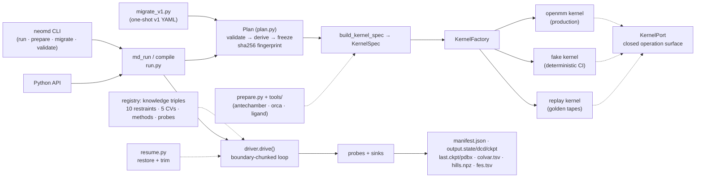

# NeoDynamics

**A molecular-dynamics SDK on OpenMM** — generic MD, well-tempered
metadynamics and steered MD behind a single facade, with a swappable
physics kernel.

Python 3.12+ · OpenMM 8.6.x · MIT license · version derived from git tags

NeoDynamics is NeoBinder's open-source project for molecular dynamics built
on top of [OpenMM](https://openmm.org/). The package contains:

- OpenMM pipelines for generic MD (`min` / `eq` / `md` / `prod`),
  well-tempered metadynamics, steered MD, GaMD, OPES, RBFE windows and ML/MM
  coupling with any TorchScript NNP (ADR-0004; QM/MM remains excluded until
  rebuilt as a qualified plugin)
- OpenMM system-building tools (protein + ligand + solvent)
- Ligand forcefield creation and support for externally supplied ligand
  forcefields (AM1-BCC/GAFF via antechamber, RESP2 charges via ORCA, or
  expert-designed parameters)

> The engine and CLI live in `src/neomd/`. The independent service package
> `src/neomd_server/` owns interactive session policy and its alternative
> driver/probes; the engine and CLI never import it. `src/neomd_legacy/` is the
> frozen v1 package (bug fixes only), kept for one deprecation release
> together with the `neomd2` script alias and the `bin/` compatibility
> wrappers.

The [interactive service driver](docs/interactive-driver.md) provides bounded
advance, pause/resume, expiring atom forces, named restraints and qualified
method controls, including ordered RBFE windows. Generic scientific stepping
and physical controls remain reusable engine interfaces. The
[service contract and PostgreSQL ledger](docs/service-ledger.md) provide owned
admission, fencing and durable command outcomes. The
[scientific protocol compiler](docs/scientific-protocol.md) binds typed methods,
CVs and restraints to verified prepared particles and immutable coordinate
references before creating a simulation context. The
[private HTTP/WebSocket transport](docs/private-transport.md) authenticates scoped
requests, streams bounded inputs and separates acknowledged events from lossy
previews. A spawned [runtime qualification probe](docs/runtime-qualification.md)
executes every built-in method on a tiny trusted system before reporting
available methods. The Linux [resident service](docs/service-runtime.md) provides
independent spawned sessions, PostgreSQL admission, bounded supervision and local
immutable checkpoint records. Checkpoint publication consumes the command's exact
capture and syncs each new inode and changed directory once before its receipt.
Its required running allowance excludes paused and
preparing/finalizing time; host budget stops have separate durable actual-engine
receipts, and unknown crash tails are never reset. Run it with `pixi run -e server serve` after setting
its explicit configuration and applying its owned schema migrations. A separately
bounded output finalizer preserves confirmed engine outcomes, retains admission
until process exit and records an exact local artifact set before publication.
Its completion transaction preserves the producer-selected result-manifest ID and
[immutable local inventory evidence](docs/service-ledger.md), including original
order and full file stat values; legacy records receive no inferred evidence.
New historical checkpoints separately retain
[exact UUID/path/stat correspondence](docs/service-ledger.md#historical-checkpoint-evidence)
in the same transaction as their ACK; this evidence grants no cleanup authority.
Its required finalization deadline has no default. The service-owned
[publication journal](docs/service-ledger.md#publication-journal) binds this
evidence to one configured destination, preserves original operation IDs across
uncertain exchanges and stores exact receipts without deleting local artifacts.
It is an integration library; the resident runtime does not activate an uploader.
CPU service tests are separate from cluster rollout and remote publication gates.
Its [sealed trajectory result manifests](docs/trajectory-results.md) bind exact
closed DCD bytes to prepared particle order, registered protocols and execution
identity, including independent RBFE windows. Local evidence remains separate
from object-store publication and download authorization.

For container packaging and api-dev operation, see the
[container guide](docker/README.md) and [deployment templates](deploy/README.md).

## Highlights

- **One facade, progressive disclosure** — `md_run(dir)` → scalar kwargs →
  full plan dict all compile to an *identical* immutable `Plan` (same sha256
  fingerprint; pinned by the round-trip test).
- **Validate everything at once** — plan validation collects *all* problems
  (not fail-on-first) and renders each with its YAML key path and a
  did-you-mean suggestion. `neomd validate plan.yaml --check-files` reports
  every issue, writes nothing, exits 2.
- **A closed physics seam (`KernelPort`)** with three adapters:
  `openmm` (production), `fake` (deterministic, openmm-free, millisecond CI),
  `replay` (golden-tape playback pinning bit-exact parity with v1).
- **Knowledge triples + registry** — restraints, collective variables,
  methods and probes are self-registering triples (schema + physics +
  observables); third-party plugins register through `neomd.register()` or
  the `"neomd"` entry-point group.
- **Deterministic resume** — a single owner restores the checkpoint and
  trims every tape to the resume step; `manifest.json` chains epochs and
  records the plan fingerprint.
- **ML/MM coupling (ADR-0004)** — a `ml_region` plan section drives
  mechanical embedding (ported verbatim from openmm-ml, with attribution) +
  any TorchScript NNP through openmm-torch; a mock NNP keeps the whole
  pipeline testable without torch. W3-c: regions extend beyond ligand-only
  to **active-site residue selectors** (`residues: ["B:JZ4", "A:102"]`;
  cross-boundary bonded terms stay MM — ADR-0004 addendum).

## Quick start

### Python — one facade, three depths

```python
from neomd import md_run

md_run("path/to/run_dir")                # L0: zero-config (reads the plan file in the dir)
md_run("path/to/run_dir", steps=50000)   # L1: scalar knobs deepen the plan
md_run(plan_dict)                        # L2: the full experiment spec
```

The **round-trip law**: L0, L1 and L2 spellings of the same experiment
compile to an identical `Plan` — one validation path, one sha256 fingerprint.

### Shell

```bash
neomd run path/to/run_dir --steps 50000                  # default: --platform cuda --kernel openmm (cpu/fake/replay available)
neomd prepare prep_config.yaml                            # system preparation (protein+ligand+solvent)
neomd migrate old_v1_config.yaml -o plan.yaml             # one-shot v1 YAML -> Plan translation
neomd validate plan.yaml --check-files                    # report every problem, write nothing
neomd version
```

Every run spelling prints by default to **stderr**: a start banner (start
time, method, every input file, the output path), the v1 progress line
(elapsed / percent / rate / ETA) refreshed in place every 5000 steps, and
an end line with the finish time and elapsed wall time. All of it travels
the `neomd` logger hierarchy at INFO — `neomd run --silent` prints nothing;
from Python, `logging.getLogger("neomd").setLevel(...)` tunes it.

### A plan file

```yaml
method: eq
steps: 5000

integrator:
  dt: 0.002
  friction_coeff: 1.0
barostat:
  frequency: 25
  pressure: 1.0
temperature: 298
seed: 0

input_files:
  complex: /work_dir/min/last.pdbx        # from the previous leg
  system: /work_dir/sys_prep/htb/system.xml
  ligands: /work_dir/sys_prep/htb/ligand.json

output:
  output_dir: /work_dir/eq
  trajectory_interval: 1000
  checkpoint_interval: 1000
```

Metadynamics swaps in `method: metadynamics`, a `colvars:` section
(1–3 collective variables from the CV vocabulary) and a `meta_set:`
section (`biasFactor`, `height`, `frequency`) — same facade, same artifacts
plus `colvar.tsv`, `hills.npz` and `fes.tsv`. Complete, runnable examples:
[examples/3HTB_complex/](examples/3HTB_complex/) (protein–ligand complex,
with the [run_v2.py](examples/3HTB_complex/run_v2.py) walkthrough) and
[examples/ala_meta/](examples/ala_meta/) (alanine-dipeptide metadynamics).

Steered MD swaps in `method: smd` and an `smd:` section whose entries use
the restraint vocabulary — any rampable key (`restr_k`, `max_nm`,
`min_degree`, `maxRMSD_nm`, `ref_position_nm`, the xyz_box
per-axis walls `min_x_nm`/`max_x_nm`/`min_y_nm`/..., ...) given a LIST
of values is piecewise-linearly interpolated over `steps` and pushed to the
kernel on a fixed 5000-step staircase (v1 semantics, verbatim). `order`
is not rampable — it stays constant (v1's `order: [2]` spelling is
accepted and means the same constant). A classic
pull is a `max_nm`/`ref_position_nm` ramp; a soft engage/release is a
`restr_k` ramp like `[0, 1000, ..., 0]`. The run writes `smd.tsv` (step +
geometric observable + current ramp values + bias energy; switch it off
with `output.report_smd: false`) alongside the usual artifacts, and a
static `restraint:` section (e.g. holding the protein) is reported to
`restraint.tsv` as in any MD run.

The coordinate artifacts (`output.dcd` frames, `last.pdbx`) are wrapped
into the periodic box whole-molecule-by-whole-molecule by default
(topology bonds; internal geometry preserved, unlike per-atom wrapping);
`output.wrap_coordinates: false` switches to raw, unwrapped coordinates,
and `neomd run --wrap` / `--unwrap` override the plan from the command
line. Checkpoints (`output.ckpt` / `last.ckpt`) are never wrapped — they
are openmm's raw state snapshots, required for bit-exact resume. Bias and
CV forces are clamped to the system's native periodicity: a periodic
restraint flag cannot flip a non-periodic system to periodic, so on such
systems wrap stays a no-op even when enabled.

## Installation

### (*preferred*) Pixi — custom runtime environment

1. Install [pixi](https://pixi.sh/latest/#alternative-installation-methods)
```bash
curl -fsSL https://pixi.sh/install.sh | sh
```

### Pixi
```bash
git clone git@github.com:NeoBinder/NeoDynamics.git
cd NeoDynamics
pixi install
pixi shell
```


## The model in one minute



### Plan — the immutable experiment snapshot

Every experiment becomes a `Plan` exactly once: **validate** (collect every
problem; errors carry the YAML key path and a did-you-mean), **derive**
(seed/temperature defaults, intervals, `continue_md` checkpoint resolution),
**freeze** (deep-frozen dict; `plan.with_(...)` returns a re-validated copy),
then a sha256 **fingerprint**. `Plan` equality *is* fingerprint equality.

### The kernel seam — `KernelPort` and three adapters

| Adapter | Role | Needs OpenMM? | Negotiated capabilities |
|---|---|---|---|
| `openmm` | production runs | yes — the only core module importing openmm | `BiasOps`, `GroupEnergy`, `StructureWriter` |
| `fake` | deterministic textbook Langevin; millisecond, openmm-free CI workhorse | no (numpy) | `BiasOps`, `GroupEnergy` |
| `replay` | plays back recorded v1 golden tapes for parity tests | no | — (unsupported columns report `nan`) |

The port is a closed operation surface (step, minimize, positions/energies,
`install_bias` → opaque force-group id, snapshot/restore) plus *optional*
capability protocols negotiated via `provides()`. Force-group ids are opaque
ints, allocated by the single `pick_free_force_group` allocator. The `replay`
adapter registers on import, so `import neomd.kernel.replay` must happen
before `KernelFactory.create(kind="replay")`.

### Knowledge triples and the registry

One module per restraint / collective variable / method / probe, each
holding **schema + force expression + observables**, injected via
`registry.register(kind, name, entry)`. Built-ins: 10 restraint types
(`distance`, `dihedral`, `angle`, `funnel`, `dist_ref_position`, `xyz_box`,
`vec_restraint`, `rmsd`, `distances` — many pairs packed into one force
per side, the v1 179ae35 group-economy type — and `boresch`), 5 CVs
(`distance`, `dihedral`, `angle`,
`min_distances`, `distance_ref`), the well-tempered `metadynamics` and
steered-MD (`smd`) methods, and 6 probe presets. Physics expressions are
ported verbatim from v1 — that is physics, not architecture. User-added
forces install under the shared-force-group policy, one group per
category: all restraints share ONE group (`restraint.tsv` carries a
single `shared_restraints__energy` total column) and all smd entries
share one group (`smd.tsv`: `shared_smd__energy`); an entry opts out
with `independent_force_group: true` for a dedicated group and its own
`{name}__energy` column.

### Driver, probes, sinks — what a run writes

| File | Writer | Content |
|---|---|---|
| `manifest.json` | driver (atomically rewritten during the run) | plan fingerprint + raw plan, versions, epoch chain (`resume:<step>`, `done:<method>`), last step per artifact |
| `output.state` | `StateProbe` | energy log, OpenMM StateDataReporter format |
| `output.dcd` | `TrajectoryProbe` | CHARMM-compatible DCD trajectory (append-aware, trimmable) |
| `output.ckpt` | `CheckpointProbe` + final write | kernel checkpoint incl. RNG state |
| `last.ckpt`, `last.pdbx` | driver, at leg end | final snapshot (+ final structure when the kernel provides `StructureWriter`; the pdbx header carries the RUNTIME periodic box — v1 8d04b0c fix — and fresh starts take the initial box from the structure file's header) |
| `restraint.tsv` | `RestraintProbe` | restraint observables + one `shared_restraints__energy` total column (shared-force-group default); `independent_force_group: true` entries get their own `{name}__energy` via `GroupEnergy` |
| `smd.tsv` | `SmdProbe` (steered MD) | per-entry geometric observable + current ramp values + one `shared_smd__energy` total column (shared-force-group default; `independent_force_group: true` entries get their own `{name}__energy`) (switch: `output.report_smd`) |
| `colvar.tsv` | `ColvarProbe` (metadynamics) | CV values in natural units (e.g. degrees) |
| `hills.npz` | metadynamics | hill ledger `{steps, positions, heights}` |
| `fes.tsv` | metadynamics | free-energy surface at run end |

All writing goes through `ArtifactSink` implementations (`LocalDirSink` for
runs, `MemorySink` for tests) — `md_run` itself writes nothing.

### Resume — deterministic continuation

Set `continue_md: true` and the same plan re-runs from its checkpoint:
`resume.plan_resume` is the single owner that restores the kernel and trims
*every* tape (`output.state`, `output.dcd`, `colvar.tsv`, `restraint.tsv`,
`hills.npz`, `smd.tsv`) to the resume step, then the probes re-open them in
append mode. Probes never decide append/truncate themselves. A resumed SMD
run snaps its ramp push to the enclosing 5000-step boundary, so the
staircase is identical to an uninterrupted run's.

### System preparation and tools

`prepare_system(config, prepared_export={})` optionally adds an immutable
source/prepared/particle UUID bundle and returns its path through
`SystemBundle.prepared_manifest`. `export_system_bundle` exports an existing
prepared system with explicit particle correspondence. See
[prepared bundles](docs/prepared-bundle.md) for source bindings, virtual sites,
units and hash verification. The engine export has no HTTP or remote storage
behavior.
Service upload commit performs large metadata and System verification in a
deadline-bound child process, then registers the exact scoped input only after
clean exit and a live upload recheck. Durable asynchronous input uses
explicit request IDs, scoped completion polling and a required pending-operation
capacity. It survives HTTP disconnect; restart never silently retries old work.
Prepared-bundle v2 intake accepts only one unchanged canonical protein load,
using the explicit SDK `canonical_protein_load_v1` profile to independently check
source graph and final correspondence. Repair and other preparation histories
remain unsupported; the generic SDK reader is not this intake gate. See the
[load-only profile](docs/protein-preparation.md#load-only-verification-profile)
for identity, label and verification limits. Remote full preparation remains unavailable;
the bounded SDK workflow is described below.
Engine startup uses compact verified metadata and bounded AtomId projection
batches. Actual public 100,000-particle intake and concurrent controls passed the
local synthetic qualification. A separate fully written 100 GB fixture passed
production finalization and resource/cleanup checks; neither gate establishes
large-system simulation throughput or OSS publication.
See [resident runtime](docs/service-runtime.md).
A separate immutable topology-view contract and child-side projector preserve
prepared atom/residue/bond/site identities and exact particle order in bounded
canonical pages. Prepared-input verification stages and atomically publishes
the exact pages; owner-scoped private GETs preserve their canonical bytes.
The public gateway preserves these bytes under session owner/provider checks.
The [public topology qualification](docs/runtime-qualification.md#public-input-and-complete-topology-reads)
entrypoint passed its 513-particle dry gate with two real CPU sessions. Its 100k
run verified every page but failed the unchanged concurrent latency gate;
the bounded checkpoint fix passes the repeated small-system baseline, while the
100k topology rerun remains pending. Native assembly/viewing remains separate from
this metadata gate; see `contracts/topology-view/v1/README.md`.

The [protein preparation foundation](docs/protein-preparation.md) adds explicit
source atom, residue, bond and sequence evidence plus observed PDBFixer heavy-atom
repair in prepared-bundle v2. Its small repair fixture verifies identity and
lineage; its mass-only System is not a simulation input. The service preparation
catalog records editable salt concentration, water-box padding and pH, with
existing input water retained before completing the water box. HMR uses4 amu,
constraints use HBonds, water is rigid, center-of-mass motion removal is
disabled (`remove_cm_motion=false`) and PME uses a 1.0 nm cutoff with tolerance
0.0005. Dispersion correction is enabled; switching, periodic exceptions and
flexible-constraint force parameters are disabled. The catalog's assembly
choices are complete. The isolated `add_ions_preserving_water` adapter counts
retained plus generated water while permitting only generated-water replacement;
it requires explicit settings and commits only after preservation checks. The bounded SDK path connects this adapter without changing CLI behavior.
The separate [permanent grouping SDK](docs/protein-preparation.md#permanent-proteinsource-water-grouping)
preserves original source identities and exact coordinates while placing protein
runs before source-water chains. Its explicit `canonical_protein_group_v1`
verifier accepts only LOAD→GROUP; grouped chain ends are not chemical termini.
The [repair lineage observer](docs/protein-preparation.md#explicit-repair-correspondence)
also accepts explicit retained-atom maps, preserving source UUIDs after reordering
without coordinate-based identity guessing. This does not itself run PDBFixer or
independently qualify a repaired history.
The [bounded grouped-repair producer](docs/protein-preparation.md#evidence-gated-grouped-heavy-repair)
now connects original source→GROUP→actual heavy repair while preserving H/water and
original identities. Missing OXT blocks without explicit complete terminal evidence;
missing backbone N/C requires complete ordered original sequence evidence and
qualified generated geometry. Inferred disulfides remain unsupported. The opt-in
`canonical_protein_repair_v1` profile independently checks exactly LOAD→GROUP→repair.
The [complete bounded SDK](docs/protein-preparation.md#complete-bounded-sdk-preparation)
adds retained-H completion with conflict rejection, retained-water solvation/NaCl,
and an atomic independently verified System bundle. Service v2 remains LOAD-only.
The separate [explicit System/report SDK](docs/protein-preparation.md#explicit-system-assembly-and-report)
now builds from an already chemically prepared v2 topology, captures exact resource
bytes and binds a separately versioned report to all exported artifacts. Its
consumer rebuilds the full System before deserializing uploaded XML. This is not
repair/H/solvation or history validation by itself; use `verify_protein_preparation`
for the full SDK guarantee. The remote preparation request remains unavailable. Existing CLI defaults and v2 LOAD-only intake stay unchanged.
The scientific protocol schema records the confirmed 2 fs (0.002 ps) initial
timestep for future new-protocol editors. Submitted timesteps remain explicit;
validation/compilation never fill an omitted value or replace a chosen value.

`neomd prepare prep.yaml` (or `prepare_system(config)`) builds
protein + ligand + solvent systems and writes `solv.pdbx`, `system.xml` and
`ligand.json`. External binaries are wrapped by subprocess-isolated adapters
in `tools/`: `antechamber` (GAFF parameterisation), `orca` + Multiwfn (RESP2
charge fitting), `ligand` (RDKit/openff processing), `convert`, `fix_protein`
(PDBFixer) and `template_xml`. All OpenMM private-API usage lives in
`openmm_privates.py` behind a pinned-version gate (openmm 8.6.x) that raises
`UpstreamVersionError` otherwise.

To inspect the prepared force field, `bin/inspect_ff_params.py` reads
`solv.pdbx` + `system.xml` and prints parameter tables for a user-selected
atom set. Selection keywords (`chain`, `resid`, `resname`, `name`,
`index`, `resindex`, `element`, `distance`) form a small expression
language: `;` / `and` / `&` are AND, `or` / `|` are OR, `not (...)` /
`!(...)` negate, `,` lists values of one keyword, and
`distance=5:(...)` keeps atoms within 5 angstrom of a parenthesised
sub-selection (precedence NOT > AND > OR) — e.g.
`chain=A and (element=C,N,O or resname=JZ4) and not (name=H)`. Repeated
`--select` groups are OR-ed. `--params` picks from the types actually
present in the XML (bonds/angles/dihedrals/nonbonded/mass) and
`--mode any|all` decides whether a bonded term is shown when it touches
the selection or only when it sits fully inside it. The same logic is
importable as `inspect_params(...)` for Python use.

## ML/MM coupling

One plan section turns a region into an ML-potential region. Two region
spellings, mutually exclusive (W3-c, ADR-0004 addendum): raw indices
(ligand-only shape, W2-d) or residue selectors (active-site regions):

```yaml
ml_region:
  residues: ["B:JZ4", "A:102", "A:133"]  # CHAIN:RESID (author numbering) or
                                         # CHAIN:NAME (e.g. the ligand);
                                         # bad selectors fail with
                                         # did-you-mean
  # indices: [1234, 1235, 1236]        # the other form: 0-based particle
                                       # indices (or "1234,1235,...")
  model:
    type: torchscript                # or: mock
    path: my_nnp.pt                  # torchscript: the model file IS the interface
    long_range_electrostatics: false # periodic systems must declare this
    periodic: true                   # optional; defaults to the system's
    # mock-only knobs: tether_k (500 kJ/mol/nm^2), repulsion_k (1 kJ/mol),
    #                 repulsion_sigma (0.15 nm)
```

For residue regions the **cross-boundary bonded terms** (bonds/angles/
torsions with any MM atom — e.g. the peptide bonds of a pocket residue)
**stay in MM**; only fully-internal ML terms are handed to the NNP (the
GROMACS QM/MM convention; link-atom capping is future work with true
QM/MM) — pinned by the boundary-matrix tests in
`tests/v2/test_mlmm_residues.py`; demo:
`examples/mlmm_ligand/run_mlmm.py --region active-site`.

The openmm adapter assembles it **before** the Context exists (never inside
`system.xml` — the NNP Force is not XML-serializable): mechanical embedding
removes the ML-ML MM terms (the ML atoms keep their MM charges for the
ML↔MM electrostatics; ported verbatim from openmm-ml 1.7, MIT, with
attribution — see `src/neomd/ml/embedding.py`), then installs the NNP force
with a force group from the shared allocator. Two model tiers:

- `torchscript` — openmm-torch `TorchForce` over your `.pt` model. Unit
  contract: the model receives the **full system's** positions (`float32`,
  `(N, 3)`, **nm** — bake the region indices into the model, TorchForce has
  no subset parameter) and must return the energy in **kJ/mol**; box vectors
  `(3, 3)` nm are fed on periodic systems. Å/eV/kcal-trained models convert
  inside their `forward`.
- `mock` — a deterministic toy potential from standard openmm custom forces
  (tethers + soft repulsion; **not physics**) that runs the whole pipeline
  with **no torch installed** — the CI tier of the two-adapters discipline.

The fake kernel ignores `ml_region` (documented). openmm-ml is deliberately
NOT a dependency (ADR-0004): only its mechanical embedding was useful, the
per-model registry was not; it survives as an optional, import-gated
cross-validation reference. The `ml` pixi environment carries the pinned
openmm-torch + torch stack (`pixi run -e ml test-ml` runs the torch-tier
tests); the default gate stays torch-free. Demo:
[examples/mlmm_ligand](examples/mlmm_ligand) (3HTB + JZ4 ligand region, min +
100 ps). Decisions and environment resolution:
[ADR-0004](docs/adr/0004-mlmm-in-tree-coupling.md); full background, the
issue #12 mapping, the unit contracts and the W3-c residue-region chapter
live in [docs/methods/mlmm.md](docs/methods/mlmm.md).

## Extending NeoDynamics

Trusted in-process hosts can pass `probes` to
`neomd.driver.prepare_method_stepper`. Omitting it or passing `None` keeps
the existing default, restraint and enabled method reporting probes; an explicit
sequence replaces that reporting list. Scientific hooks, method state,
checkpoints and finalization remain independent, so `probes=[]` does not mean
file-free execution. This engine interface does not change CLI options or output
defaults.

The resident service supplies its own explicit reporting assembly in
`neomd_server.probes` while preserving configured archive files. Its live sampler
reads positions on the session owner thread and uses the existing bounded preview
channel; file reports and live observations have separate responsibilities.

Register a knowledge triple — the registry is the public plugin surface
(`neomd.register`). A method plugin mirrors the metadynamics shape
(`schema` + `prepare(kernel, plan, sink, logger) -> PreparedMethod`):
install your biases, then hand the driver your `on_step` hook, tape probes
and a `finish` — the driver runs the loop and owns all reporting (the
restraint tape, and whether your tapes run at all). Importing your
module self-registers:

```python
from types import SimpleNamespace
from neomd.driver import PreparedMethod
from neomd.kernel.port import BiasIR, Param
from neomd.registry import register

SCHEMA = {
    "required": {"steps": "int", "temperature": "number (K)"},
    "optional": {"meta_set.my_method": "settings carried inside meta_set"},
}

def prepare(kernel, plan, sink=None, logger=None):
    bias = BiasIR(
        kind="CustomCentroidBondForce",
        energy="0.0*k",                       # your potential expression here
        params={"k": Param(0.0, "dimensionless")},
        groups=[[0], [1]],
        periodic=False,
        label="my_method",
    )
    fgroup = kernel.install_bias(bias)         # opaque force-group id

    def finish(result):                        # end-of-run artifacts
        from neomd.driver import CHECKPOINT_FILENAME
        if sink is not None:
            sink.write_bytes(CHECKPOINT_FILENAME, kernel.snapshot())
        return result

    return PreparedMethod(
        fgroups={"my_method": [fgroup]},       # informational
        finish=finish,
        # on_step=..., on_step_interval=..., tapes={...} as needed
    )

register("method", "my_method", SimpleNamespace(schema=SCHEMA, prepare=prepare))
```

Notes: `plan.KNOWN_KEYS` is a closed whitelist today, so plugin settings ride
inside the whitelisted `meta_set` mapping section (the documented v2 path).
For installable distributions, declare the `"neomd"` entry-point group:

```toml
[project.entry-points."neomd"]
my_method = "my_package"      # importing my_package self-registers
```

A complete, tested drill lives in
[examples/gamd_drill/](examples/gamd_drill/) — an out-of-tree mini-distribution
validating registration, entry-point discovery and `drive()` dispatch on both
the fake and openmm kernels.

## Migrating from v1

`neomd migrate old_config.yaml -o plan.yaml` (or
`python -m neomd.migrate_v1`) translates a v1 run config into a v2 plan:
dead keys produce warnings, `method` synonyms map (`minimization → min`,
`equilibration → eq`), paths are absolutised against `--base-dir`, and
validation errors are relocated to the original YAML `file:line`. `qmmm`
configs are rejected (broken in v1; it returns as a 2.x plugin). The
translator is a one-shot tool, not a compatibility layer. The old `bin/`
entry points remain thin wrappers for one release.

## Testing and CI

Hosted CI skips tests marked `cuda` using `PYTEST_ADDOPTS=--skip-cuda`;
these include integration tests that use the default CUDA platform. CPU,
fake-kernel, and golden tests remain enabled. Use the same option for a
local CPU-only run; omit it on a CUDA machine to run the GPU cases too.

```bash
pixi run test          # pytest -m 'not golden and not legacy' — the CI gate (~6 min)
pixi run test-golden   # bit-exact parity vs recorded v1 tapes (~3 min)
pixi run test-legacy   # frozen-v1 live tests (opt-in, not in CI)
pixi run -e ml test-ml # ML/MM torch tier (openmm-torch + torch env; see ADR-0004)
```

- `tests/v2/` — unit + e2e over public interfaces on the fake kernel
  (millisecond tier), including the round-trip-law test and **source-scan
  tests** that enforce the architecture: no `kernel.simulation` reach-through
  outside `kernel/`, no openmm private API outside `openmm_privates.py`, no
  torch/openmmtorch imports outside `src/neomd/ml/`.
- `tests/v2/test_mlmm.py` — the ML/MM coupling: mock pipeline + embedding
  semantics in the default (torch-free) gate, checked analytically with
  CPU-appropriate tolerance and a strict double-precision Reference tier;
  TorchScript round-trip and the
  openmm-ml cross-validation behind `pytest.importorskip` (ml env).
- `tests/golden/` — the record / trim / compare harness and 9 committed v1
  tapes. CI uses the statistical tier (`NEO_GOLDEN_TOLERANT=1`); bit-exact
  comparisons are for reruns on the recording machine. The spine gate applies
  the selected tier to every sample, including step 0; both tiers require
  nonempty energy/frame samples and matching sample counts. Golden samples catch
  behavior changes; they do not prove physical correctness.

## Documentation

- [AGENTS.md](AGENTS.md) — stable contributor constraints and conditional documentation entry points
- [docs/adr/0001-neomd2-strangler-migration.md](docs/adr/0001-neomd2-strangler-migration.md) — ADR: why a same-repo strangler migration
- [docs/adr/0004-mlmm-in-tree-coupling.md](docs/adr/0004-mlmm-in-tree-coupling.md) — ADR: in-tree `KernelSpec.ml_region`, the no-openmm-ml decision, the pinned ml environment

## Versioning and license

Version numbers are derived from git tags via
[versioningit](https://github.com/jwodder/versioningit) — nothing is
hardcoded. OpenMM upgrades are explicit events: the version is pinned in
`pyproject.toml` ([tool.pixi]), the `openmm_privates.py` gate is re-verified and golden tapes
re-recorded. MIT license — see [LICENSE](LICENSE).
